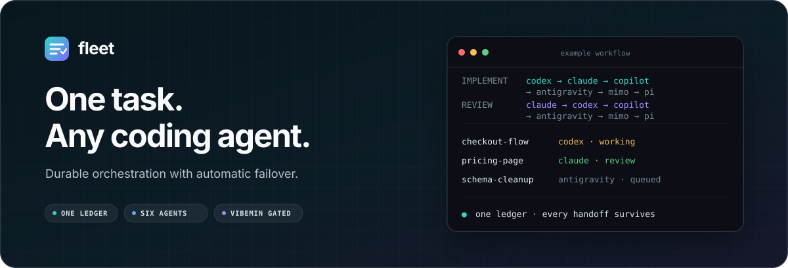

<div align="center">
  
</div>

<div align="center">

[](https://github.com/francescoVaglienti/starfleet/actions/workflows/ci.yml)
[](https://www.python.org/)
[](https://nodejs.org/)
[](LICENSE)

**One durable task ledger for Codex, Claude Code, GitHub Copilot, Antigravity, Xiaomi MiMo, and Pi.**

Fleet routes work to the best available coding agent, survives provider limits, and keeps every
task isolated and ready for a cold handoff.

[Quick start](#quick-start) · [Opinions](#opinionated-by-design) · [Routing](#routing-and-models) · [MCP](#codex-and-claude-mcp) · [Safety](#safety-model)

</div>

---

Coding-agent sessions are temporary. The work should not be.

Fleet keeps intent, current state, next steps, landmines, and handoffs in a Markdown ledger
outside every vendor's context window. When one backend runs out of capacity, another reads the
same ledger and continues in the same isolated worktree.

> Context is rented. State is owned.

Illustrative output with all six backends installed and no active tasks:

```console
$ fleet status
BACKENDS
  claude       ok claude-opus-5
  codex        ok gpt-5.6-sol
  copilot      ok gpt-5.3-codex
  antigravity  ok gemini-3.8-flash-high
  mimo         ok mimo-v2.6-pro
  pi           ok backend default · v1.5.2

ROUTING
  manage       codex → claude → copilot → antigravity → mimo → pi
  implement    codex → claude → copilot → antigravity → mimo → pi
  review       claude → codex → copilot → antigravity → mimo → pi
  chore        codex → claude → copilot → antigravity → mimo → pi

TASKS
  (none)
```

## Quick start

Install from this repository. Registry publication is pending: the npm name is not yet
published, and ownership of the existing `fleet-ai` entry on PyPI is unverified. Do not install
that PyPI entry as Fleet.

You need Git, Python 3.10+ with `uv`, and at least one installed, authenticated agent CLI.
Choose one runtime; both provide the same `fleet` command and share local state.

```sh
git clone https://github.com/francescoVaglienti/starfleet.git
cd starfleet
uv tool install .
```

For the Node runtime, also install Node 22+ and pnpm, then build and install the local tarball.
The pack step runs tests and checks the tree, fleet-ai and pi-fleet npm tarballs, Python sdist, and wheel:

```sh
pnpm install --frozen-lockfile
uv sync --frozen
npm pack
npm install --global ./fleet-ai-0.2.0.tgz
uv tool install vibemin
```

The Node runtime requires Node 20+; source development and release checks require Node 22+.

Then initialize Fleet and connect it to installed agent hosts:

```sh
fleet init
fleet setup all
```

`fleet setup all` installs the generic Fleet skill, registers the same stdio MCP server, and
configures each host's best supported status bar. Restart existing agent sessions once so they
discover the new tools.

Configure a project and its Vibemin checks in `~/.fleet/policy.yaml`:

```yaml
projects:
  /absolute/path/to/my-app:
    trust: trusted
    baseBranch: main
    vibemin:
      checks:
        - pnpm test
        - pnpm run lint
        - pnpm run typecheck
```

Create and run a task:

```sh
fleet task new checkout-flow \
  --title "Build the checkout flow" \
  --project /absolute/path/to/my-app

fleet run checkout-flow --prompt "Build the feature end to end."
fleet task done checkout-flow
```

By default, the final command runs Vibemin across the complete feature diff. If checks are absent, Vibemin
is unavailable, or minimization fails, Fleet refuses to mark the task done or clean its worktree.

## Built for agentic coding

| Capability | What it gives you |
| --- | --- |
| **Durable ledger** | Any vendor can continue a task cold without reconstructed chat context. |
| **Isolated worktrees** | Agents never author in your main checkout, so parallel tasks do not collide. |
| **Automatic failover** | Rate limits, quota exhaustion, and auth failures route to the next healthy backend. |
| **Project-aware models** | Projects override routing, model, and effort without forking Fleet. |
| **Vibemin completion** | By default, code is minimized under checks before a task becomes done. |
| **One event bus** | Starts, tools, failures, handoffs, and completion gates share an append-only log. |
| **Dual runtime** | The Node and Python implementations share state, core commands, MCP tools, and contract tests. |

## Opinionated by design

Fleet keeps a few firm rules: task state lives in a ledger, each task uses a worktree,
capacity failures can trigger failover, and completion uses Vibemin checks by default. Worktrees
separate Git changes; they are not a security sandbox.

The application guidance is intentionally small: deliver working behavior with end-to-end
checks and a README with setup, usage, and known limits. Fleet does not choose a framework,
database, visual style, or README layout for you. Task requirements and the repository's
existing choices take precedence.

Set your own guidance in `~/.fleet/policy.yaml`:

```yaml
defaults:
  applicationStack:
    frontend: Use the project's existing frontend
    backend: Use the project's existing services
    delivery: A working application with end-to-end checks
    presentation: Follow the repository's documentation style
projects:
  /absolute/path/to/my-app:
    applicationStack: false
```

All four text fields are optional. Global `defaults.applicationStack` replaces the bundled
block; project fields merge over it. Set either block to `false` to disable it at that level.
For other preferences, use private `~/.fleet/DIRECTIVES.md` or scoped files under
`~/.fleet/directives/` with an `<!-- applies-to: /absolute/project/path -->` marker.

Routing and model choices are editable policy, not a claim that one provider is best.
`cleanup.onDone: false` disables automatic worktree removal; `cooldown` adjusts retry timing.
Vibemin completion checks are required by default and configured per project. Setting
`vibemin.required: false` globally or in a project skips that gate; completion then carries no
Vibemin validation guarantee.

## Routing and models

The default chains include all six backends. Uninstalled or cooling-down backends are skipped.
Choose a reviewer from a different model family; routing does not enforce that automatically.

| Role | Default chain | Default use |
| --- | --- | --- |
| `manage` | Codex → Claude → Copilot → Antigravity → MiMo → Pi | planning and triage |
| `implement` | Codex → Claude → Copilot → Antigravity → MiMo → Pi | feature implementation |
| `review` | Claude → Codex → Copilot → Antigravity → MiMo → Pi | review |
| `chore` | Codex → Claude → Copilot → Antigravity → MiMo → Pi | repository chores |

The bundled `DEFAULT_POLICY` uses these model identifiers; availability depends on your CLI and account:

```yaml
models:
  codex: {model: gpt-5.6-sol, effort: high}
  claude: {model: claude-opus-5, effort: high}
  copilot: {model: gpt-5.3-codex, effort: high}
  antigravity: {model: gemini-3.8-flash-high, effort: high}
  mimo: {model: mimo-v2.6-pro, effort: high}
  pi: {effort: high}
```

MiMo uses the Claude CLI with `MIMO_API_KEY` in the environment and sends prompts to
`https://token-plan-ams.xiaomimimo.com/anthropic`, Xiaomi's European endpoint. Its
configured effort is not sent because that proxy does not accept Claude's effort field. A
missing or blank key stops the run before the CLI starts; inherited Claude OAuth tokens are cleared.

Project policy overrides both without changing global behavior:

```yaml
projects:
  /absolute/path/to/important-app:
    routing:
      manage: [codex, claude]
      implement: [codex, claude]
      review: [claude, codex]
    models:
      codex: {model: gpt-5.6-sol, effort: max}
      claude: {model: claude-opus-5, effort: high}
```

Routing precedence is task ledger → project policy → global policy. Model and effort
precedence is project policy → global policy. Preview the effective project choice with:

```sh
fleet route implement --project /absolute/path/to/important-app
```

### Pi backend

Install [Pi](https://pi.dev) and configure credentials for your chosen provider. Fleet uses
`pi -p --mode json` in the task worktree. Pi 1.5.2 is the tested CLI version; `fleet status`
reports the installed version. Both the npm and Python runtimes support:

```sh
fleet delegate checkout-flow --backend pi --prompt "Build the feature end to end."
fleet run checkout-flow --backend pi --role review --prompt "Review the change."
```

Fleet leaves `models.pi.model` unset and sends no `--model` flag, so Pi uses its configured
default or its own selection among available providers. Choose a default in Pi with `/model`
and Ctrl+S. To override it for Fleet, set `models.pi.model` in `~/.fleet/policy.yaml` to
`provider/id[:thinking]`; `pi --list-models` lists the installed catalog and usable providers.
Existing policy files keep their explicit model override; remove that key to use Pi's default.
After a run, Fleet status shows the last provider/model reported by Pi as `last resolved`.
This is an observed past selection, not a prediction of the next run or an authentication check.
Before the first response it shows only `backend default`. Pi reads its own credentials
or provider environment variables; Fleet does not copy credentials. `models.pi.effort` sets
`--thinking` and overrides any model suffix. `off`, `minimal`, `low`, `medium`, `high`, `xhigh`,
and `max` pass through; `none` maps to `off`, and `ultra` maps to `max`. Other values fail clearly.
Pi clamps the level to the model's capabilities.

Sessions live under `$FLEET_HOME/sessions/pi/task-<encoded-task-id>/` (default `~/.fleet`),
using `run-<run-id>` as the session ID. Each delegation starts a fresh session; the ledger
supplies the handoff. Keeping Pi's session files lets you inspect or explicitly resume a run
with `pi --session <session-file>` without filling your interactive session list. Session
files may contain task content and tool output, just like Fleet's logs. Purging a task's
ledger and logs also removes its Pi sessions.

Pi review roles and `--read-only` runs allow only `read`, `grep`, `find`, and `ls`, disable
extensions and MCP, and exclude shell and write tools. These runs cannot run `git diff`, `git status`, or shell-based tests. Provide a saved diff
or include the diff in the review prompt when needed.
All Pi runs ignore trust-gated project configuration with `--no-approve`; context files still
load. Pi runs with the caller's OS permissions, so a worktree is not an OS sandbox. Fleet's
permission-file compiler does not configure Pi. Use an external sandbox for stronger isolation.

Pi's completed assistant messages supply text and usage once, without duplicating streaming
deltas. The runner owns the final success/error event, after Pi settles any retries. Truncated
or deferred responses count as failed work. Failed runs record the failure in the ledger;
partial output stays in the run log and Pi session. Missing-key
auth failures are observed; provider quota, rate-limit, and other auth wording remains marked
unverified in the adapters until captured from a real failure. Existing policy routing overrides
are preserved; append `pi` to those chains yourself to enable automatic routing there.

## How handoff works

Every task owns:

- a ledger at `~/.fleet/ledger/<task>.md`;
- one worktree per participating repository;
- a conventional task branch;
- per-run JSONL logs and entries in the shared event bus.

The ledger contains intent, constraints, current state, the ordered queue, landmines, open
questions, and an append-only handoff log. Every delegated prompt includes it and requires the
agent to update it before returning.

Fleet fails over only on capacity failures such as quota, rate limits, or authentication. A
plain non-zero exit normally indicates a problem with the task, so Fleet stops instead of
spending a second provider's budget on the same failure. Three consecutive ordinary failures
temporarily cool a backend down.

## Vibemin is the completion gate

[Vibemin](https://github.com/francescoVaglienti/vibemin) removes lines from an AI-generated Git
diff while keeping the checks you chose green. The Python distribution installs it as a required
dependency; npm users install it separately with `uv tool install vibemin`.

Fleet runs Vibemin with each worktree's recorded base so committed and uncommitted feature work
is considered together. Project policy can pass every Vibemin guardrail:

```yaml
projects:
  /absolute/path/to/my-app:
    vibemin:
      checks: ["pnpm test", "pnpm run lint", "pnpm run typecheck"]
      securityChecks: ["pnpm test -- security"]
      preserveOutput: ["./scripts/render-contract --hash"]
      finalChecks: ["pnpm audit --audit-level high"]
      maxAttempts: 500
      timeout: 300
```

MCP clients cannot write `status: done` through a checkpoint. They must call `fleet_task_done`,
which uses the same configured gate as `fleet task done`, including the policy opt-out.

## Codex and Claude MCP

```sh
fleet setup codex
fleet setup claude
```

| Experience upgrade | Claude Code | Codex | Copilot | Antigravity | MiMo | Pi |
| --- | :---: | :---: | :---: | :---: | :---: | :---: |
| Automatic MCP setup | ✅ | ✅ | ❌ | ❌ | ❌ | ❌ |
| Automatic status bar setup | ✅ | ✅ | ❌ | ❌ | ❌ | ❌ |
| Execution backend | ✅ | ✅ | ✅ | ✅ | ✅ | ✅ |

`fleet setup all` installs the MCP, the Fleet skill, and the best status bar each client
supports. Claude gets a live Fleet-aware command bar. Codex gets a native bar with model,
project, branch, run state, task progress, context, and rate-limit visibility. Existing status
line choices are preserved, merged, and backed up rather than silently discarded.

Both hosts receive these tools:

| Tool | Purpose |
| --- | --- |
| `fleet_status` | Backend health, model preferences, cooldowns, and active tasks |
| `fleet_task_new` | Ledger plus isolated worktree |
| `fleet_delegate` | Project-aware routing and optional background execution |
| `fleet_checkpoint` | Durable state, queue, landmines, questions, and handoff updates |
| `fleet_task_done` | Configured Vibemin gate and completion |
| `fleet_ledger_read` | Complete cold-start context for a task |
| `fleet_events` | Poll background activity and failures |
| `fleet_route_preview` | Effective backend chain and skipped providers |
| `fleet_clear_cooldown` | Restore a recovered backend |
| `fleet_worktrees` | Branches, paths, and dirty state |

Claude Code accepts arbitrary command status lines, so `fleet statusline` renders live Fleet
locks directly. Codex's current TUI status line exposes built-in fields only, so Fleet configures
the richest supported native view and keeps live Fleet runs available through `fleet_status`.
Fleet does not pretend a custom Codex status item exists when the client does not provide that
extension point.

## Pi coding agent

The [pi-fleet package](pi-extension/README.md) adds Fleet's ten tools to Pi, with live
run status, a widget above the editor, and a `/fleet` task overlay. It uses the installed
Fleet executable and ships the same Fleet skill. See its README for npm and git installs,
mode support, and local development.

## One policy, three vendors

`fleet policy sync` compiles the command, write, network, and project trust policy into each
vendor's native configuration:

| Vendor | Target |
| --- | --- |
| Claude | `~/.claude/settings.json` |
| Codex | `~/.codex/rules/fleet.rules` and a marked block in `config.toml` |
| Copilot | `~/.copilot/permissions-config.json` |

Only Fleet-managed entries are replaced. Existing files are backed up under
`~/.fleet/backups/`, and hand-written configuration outside Fleet's ownership survives.

## Safety model

- Agents run in task worktrees rather than the main checkout.
- Only exhaustion triggers cross-provider retry.
- Live locks prevent two agents from mutating the same worktree concurrently.
- Pass `--read-only` for reviews to restrict tools or select the CLI's plan mode. Pi review roles
  select it automatically; the limits and test restrictions are listed in [SECURITY.md](SECURITY.md).
- Some backends bypass interactive permissions and inherit the parent environment. Use trusted
  repositories and see [SECURITY.md](SECURITY.md) before delegating.
- Cleanup refuses in-progress work, live runs, dirty worktrees, invalid registrations, failed
  secret salvage, and unsafe multi-repository partial cleanup.
- Ignored `.env`, key, certificate, and credential files are copied to
  `~/.fleet/salvage/<task>/` before worktree removal.
- Unmerged or not-fully-pushed branches are retained.
- Branches, ledgers, and logs are kept by default.

Run `fleet prune --dry-run` before a large cleanup sweep.

## Privacy boundary

The repository and packages contain implementation, public defaults, and generic examples.
Personal project paths, task content, directives, ledgers, logs, health state, notifications,
and routing overrides live under `~/.fleet/` and are never packaged.

Run `sh scripts/check-public.sh` before release. It scans tracked working files and builds and
scans the actual fleet-ai and pi-fleet npm tarballs, Python sdist, and wheel. `prepack` and CI run the same gate.
Generic checks cover absolute home paths, non-example email addresses, credential shapes,
private keys, and unexpected package files. This is a release check, not a full secret audit. It scans UTF-8 and BOM-marked UTF-16 text;
encoded or binary payloads may hide secrets it cannot recognize.

Keep extra case-insensitive regular expressions, one per line, in an ignored `.private-denylist`
in the main checkout. Worktrees find it through Git's common directory. A worktree-local file
takes precedence; `FLEET_PRIVATE_DENYLIST` can name an explicit file and fails if it is missing.
Blank lines and lines starting with `#` are ignored. CI uses generic checks unless that file is
provided privately. The gate reports how many local patterns it loaded and never prints matches.

Publish fresh history, not the private development history:

```sh
sh scripts/export-public.sh /tmp/fleet-public-export
```

The target must not exist. The script copies tracked working files (including staged additions
and current edits), checks source and built packages, and creates one commit with a neutral
release identity, no remotes, and no push. Stage intended new files first. Untracked files,
local denylist, old commits, Git config, hooks, and credentials are not copied. The same local
patterns apply to the export without being included in it. If checks fail, the script exits
nonzero and leaves the target for inspection without a release commit.

## Dual-runtime parity

Fleet builds Node and Python packages named `fleet-ai`. Both expose the `fleet` executable and use
the same `~/.fleet` files. A cross-runtime test executes both implementations and compares:

- default and project routing;
- model and effort precedence;
- fallback application stack;
- branch rendering;
- backend CLI arguments, including Pi thinking levels and review restrictions;
- Pi event, usage, retry, and provider-failure contracts;
- Vibemin completion arguments;
- Claude and Codex TUI integration defaults.

CI also runs the TypeScript cleanup suite and Python behavior suite. Versions move together.

## CLI essentials

```text
fleet init
fleet status
fleet task new <id> --title <title> --project <path>
fleet task list
fleet task show <id>
fleet task done <id>
fleet task rm <id> [--force] [--purge-ledger]
fleet run <id> --prompt <task> [--role <role>] [--backend <backend>]
fleet delegate <id> --backend pi --prompt <task>
fleet takeover <id>
fleet route <role> [--project <path>]
fleet watch [--task <id>]
fleet log [--task <id>] [-n <count>]
fleet worktrees --project <path>
fleet prune [--dry-run]
fleet policy show|edit|sync
fleet setup codex|claude|all
fleet statusline
fleet clear-cooldown <backend|all>
fleet mute [--hours <n>] [--minutes <n>]
fleet unmute
fleet mcp
```

## Development

```sh
pnpm install --frozen-lockfile
uv sync --frozen
pnpm test
uv run pytest -q
uv run ruff check fleet tests scripts
uv run ruff format --check fleet tests scripts
sh scripts/check-public.sh
```

See [CONTRIBUTING.md](CONTRIBUTING.md) for release checks and the parity rule.

The TypeScript and Python implementations are intentionally kept side by side. A behavioral
change is incomplete until both runtimes and the parity contract agree.

## Known limits

- The core command set is shared; some flags and output formats differ. Run `fleet --help`
  for your installed runtime. Node supports `watch --all`; Python does not. Use long duration
  flags for `mute` across runtimes.
- Vendor JSONL formats are experimental and may require parser updates.
- Exhaustion detection relies on provider error wording.
- Codex currently has no arbitrary command-backed TUI status-line field.
- Vibemin is only as strong as the configured checks.

Fleet makes handoff durable, not magical. Keep the ledger honest and review the final diff.
